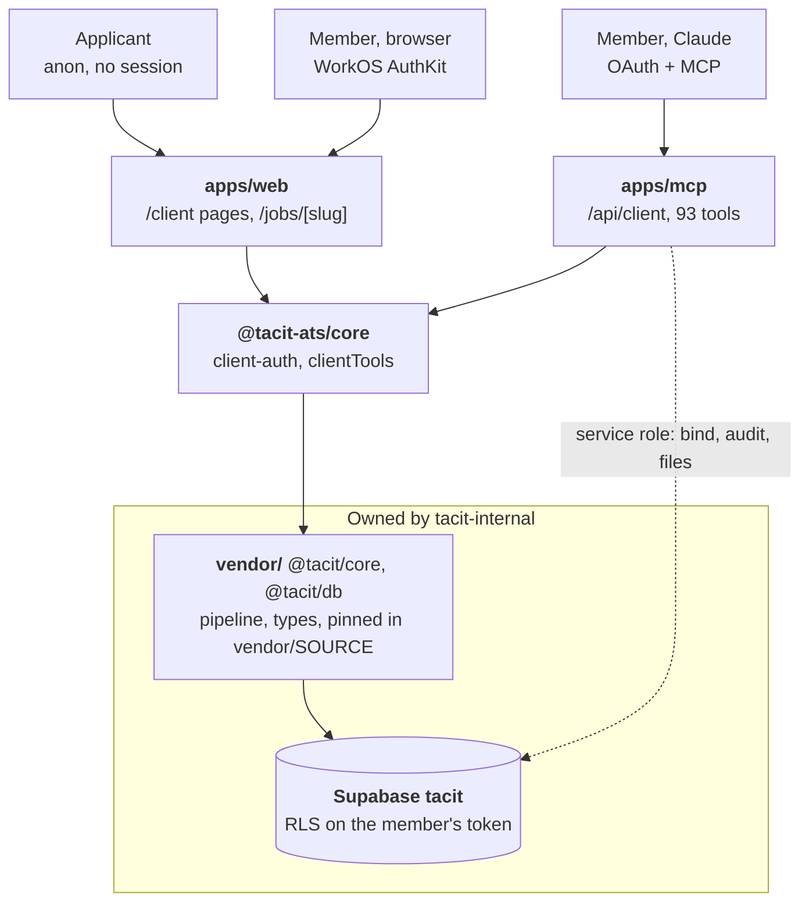
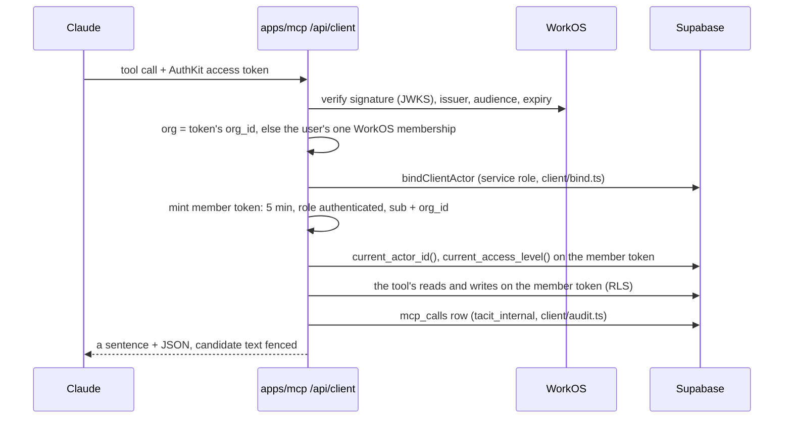
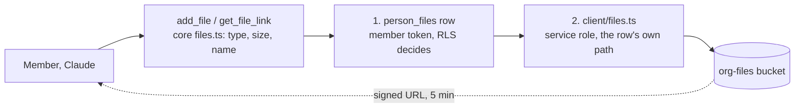

# Tacit ATS architecture

## Scope and status

Tacit ATS is the client-facing applicant tracking system: the place a client company's own team works its jobs, candidates, pipeline, interviews, offers and candidate email inside Tacit, on the Ashby / Greenhouse model. It reaches members two ways: a web area they sign in to, and an MCP connector they add to Claude.

This repo was split out of Tacit-Awareness/Tacit-Awareness, now [tacit-internal](https://github.com/Tacit-Awareness/tacit-internal), on 2026-10-14. It is one product with that repo, on one database: tacit-internal owns the schema, the access policies and the shared pipeline logic, and this repo consumes them.

Status: the web area, the public job posts and the connector's 93 tools are built and tested (unit tests in CI, integration tests against a local Supabase stack). Production is set up: the web area serves `ats.tacitawareness.com`, the connector `ats-mcp.tacitawareness.com/api/client`, and on 2026-10-15 a test client org's admin signed in through both and stored and fetched a file. No real client company is on it yet. Open items are listed at the end.

Each folder's `CLAUDE.md` has the detail behind every section here.

## Components

| Component | Choice | Purpose |
|---|---|---|
| Member web area (`apps/web`) | Next.js App Router, WorkOS AuthKit, Vercel | `/client`: jobs, the pipeline board, the team and invitations, the connector's docs. Public `/jobs/[slug]` posts and their application form. |
| Client connector (`apps/mcp`) | Next.js, one MCP route `/api/client`, AuthKit OAuth, Vercel | The MCP server a member adds to Claude: 93 tools over their company's hiring data. |
| Domain logic (`packages/core`, `@tacit-ats/core`) | TypeScript, dependencies injected | First sign-in binding, a client admin's invitations, and every connector tool (`clientTools`). Never reads `process.env` or builds a client at module load. |
| Shared Tacit code (`vendor/`) | Built tarballs of `@tacit/core` and `@tacit/db` | The pipeline (the only writer of `applications` / `application_events`), generated types, token minting, email pieces. Pinned in `vendor/SOURCE`, refreshed with `pnpm sync:tacit`. |
| Database and identity | Supabase Postgres (project `tacit`), RLS | One org per client company (Tacit is org #1). Every member query runs as `authenticated` on their own token. |
| File storage | Supabase Storage, private `org-files` bucket | Candidates' resumes and attachments, reached only through signed links. |
| Identity provider | WorkOS (the client environment) | One WorkOS organization per client org; AuthKit sessions for the web, AuthKit OAuth for the connector, invitation emails. |
| Email | Resend | Candidate email drafted and sent from the connector. Unset = drafts only. |

## Relationship with tacit-internal

- **Schema.** Migrations, RLS policies, the definer functions this repo calls (`invite_org_member`, `client_claim_write`, `my_interviews`, `submit_job_application`, ...) and the generated types live in tacit-internal's `packages/db`. A feature here that needs a schema change lands its migration there first (that repo's CI pushes it to production on merge), then `pnpm sync:tacit` here.
- **Shared logic.** The pipeline, the staff connector's email helpers, `wrapUntrusted` and `renderTemplate` come from `@tacit/core`. Code is never copied across: a missing export is added there and synced.
- **Onboarding.** A client org and its first admin are always created from Tacit's ATS Admin (`/admin/orgs` in tacit-internal's `apps/internal`, staff admins only). Nothing here creates an org; a first sign-in here only binds the actor that page (or a client admin) invited.
- **Docs.** `apps/web/src/lib/docs/client-pages.ts` is the source of the connector's docs; tacit-internal's staff `/docs` shows a copy.

## Identity and sign-in

**Web.** `proxy.ts` covers `/client/**` only. A member signs in with WorkOS AuthKit (`wos-session`). Supabase trusts WorkOS's user-management issuer as third-party auth, and the JWT template carries `role: authenticated` and `org_id`, so `lib/client/session.ts`'s `resolveClient()` builds a per-request client on that token and asks the database who it is (`current_actor_id()`). Invitations accepted at WorkOS land on `/client/callback` without our PKCE cookie; the callback answers with a "your account is ready, continue" link instead of an error.

**Connector.** An MCP client signs in through AuthKit's OAuth server, whose tokens Supabase does not trust. So each request is exchanged:

No token or the wrong audience is a 401 pointing at `/.well-known/oauth-protected-resource/api/client`; a valid token that is not an invited member is a 403 with no names.

**Binding.** `bindClientActor` resolves a returning user by subject, and a first sign-in by verified email to the actor an admin invited inside the token's org. It never creates an actor.

## Authorization

The database decides everything. Pages and tools do not filter by org; they read and write on the member's own client and RLS returns exactly what that member may see. Access is spoken as interviewer / hiring team / admin (the column's `limited` / `elevated` / `admin`).

What the code adds on top: before a write, it asks the policies' own helpers (`can_on_role`, `can_add_people`, `can_edit_application`) so a refusal is a sentence (`ClientToolError`: `not_found`, `forbidden`, `invalid`, `rate_limited`) rather than a write that silently changed nothing.

**Privileged clients.** Only these modules may name the service role or `tacit_internal`, each exporting functions and never a client:

| Module | Role | Why |
|---|---|---|
| `apps/web` `lib/client/bind.ts` | service role | First sign-in binding |
| `apps/mcp` `client/bind.ts` | service role | First sign-in binding |
| `apps/mcp` `client/audit.ts` | `tacit_internal` | `mcp_calls` rows and the read-breadth ceiling, which members cannot read |
| `apps/mcp` `client/files.ts` | service role | Signing and uploading `org-files` objects |
| `apps/mcp` `client/calendar.ts` | service role | Members' calendar refresh tokens, which no member token can read |

`apps/web/src/client-area.test.ts` and `apps/mcp/src/client-connector.test.ts` walk the imports and fail on any other path. The web test also fails on a server action that does not start with `await requireClient()`, since an action is callable by id from any page and the proxy does not cover it.

**Public job posts** (`/jobs/[slug]`, `/api/jobs/[slug]/apply`) sit outside the session entirely: they run as `anon` on the publishable key and may call only `job_post_public` and `submit_job_application`.

## The client connector

Each tool in `apps/mcp/src/client/server.ts` is a thin wrapper over one `clientTools` function in `@tacit-ats/core`, called with the member's client and a `ClientToolCtx` (`actorId`, `orgId`, `accessLevel`, `source`). Reads carry `readOnlyHint`, risky writes `destructiveHint`.

| Area | Module | Tools (examples) |
|---|---|---|
| Pipeline | `reads.ts`, `writes.ts` | `whoami`, `list_jobs`, `get_pipeline`, `search_candidates`, `add_candidate`, `update_stage` |
| Admin | `admin.ts` | `create_job`, `update_job`, hiring team, `set_member_access`, invitations |
| Interviews | `interviews.ts`, `calendar.ts`, `plans.ts`, `scorecards.ts` | `find_interview_times`, `schedule_interview` / `update_interview` on the member's Google Calendar, feedback, plans, scorecards |
| Offers | `offers.ts`, `approvals.ts` | `create_offer`, `update_offer`, rejection reasons, approval flows |
| Candidates | `files.ts`, `activity.ts`, `tags.ts`, `pools.ts`, `merge.ts` | files, history, tags, prospects and pools, duplicates, merge, GDPR anonymize |
| Org structure | `structure.ts`, `openings.ts`, `custom-fields.ts` | departments, offices, openings, custom fields |
| Outreach | `email.ts`, `posts.ts` | templates, `draft_email` / `send_email`, job posts, applications inbox |
| Reports | `reports.ts`, `eeoc.ts` | pipeline, source, time to hire, rejections, interviewer activity, offers, suppressed EEO totals |

**Audit and limits.** Every call is an `mcp_calls` row (`client:<tool>`). Reads sit behind a ceiling of 150 distinct candidates per member per hour. Every write is an `audit_log` row claimed through `client_claim_write` before it happens and finished after (`withAudit`), at most 300 per member per hour. Candidate email is capped at 30 sends an hour in the database.

`apps/web`'s docs test fails when the tool reference lists a tool that is not registered, or misses one that is.

## File storage

Files live in the private `org-files` bucket at `<org_id>/<person_id>/<file id>`. The bucket has no Storage policies, so a member's token cannot touch it at all.

The member's own client reads or inserts the `person_files` row first; only then does `client/files.ts` sign or upload, always on that row's path, never one from input. Uploads are pdf, doc, docx, txt, png or jpeg, at most 3 MB, and never overwrite. The only delete is `removeFiles`, after `anonymize_candidate` has deleted the rows and returned their paths. An interviewer sees only the resume of someone they interview.

## Privacy

- Interview feedback notes, rating notes, offer notes, email subjects and bodies, filenames and source details are kept out of `audit_log` and `mcp_calls`.
- Candidate-written text (names, headlines, notes, answers) comes back fenced as untrusted data. Ids, stages, job titles and teammates are bare.
- Offer terms are returned only to the member asking. Feedback is visible as the org's `feedback_visibility` allows.
- EEO answers are voluntary, collected only on the public application form, and members see only an admin's suppressed totals.

## Deploy and configuration

Two Vercel projects, `apps/web` and `apps/mcp`, each with its own `vercel.json`. A merge to `main` deploys; CI (`.github/workflows`) runs build, typecheck and unit tests on pull requests. Integration tests need tacit-internal's migrations on a local stack and run locally (`pnpm test:integration`).

Configuration is in `.env.example`. Each app stays dormant until its required variables are set: `/client` answers 404, `/api/client` answers 503. Optional variables turn features off cleanly: no `RESEND_API_KEY` means drafts only, `CLIENT_FILES_DISABLED` means no file links or uploads.

## Open items

- Google has not verified the calendar app yet (Linear ENG-7). Until it does, only the OAuth client's listed test users can connect a calendar, they see an unverified-app warning, and their connections expire after 7 days while the app is in Testing. The OAuth client and `CLIENT_GOOGLE_CLIENT_ID` / `_SECRET` are set on both apps. Microsoft calendars are not supported.
- Whether AuthKit's MCP access tokens carry `org_id` is still not known: the first connector sign-in found the right org, but which of the two paths found it was not recorded.
- Not exercised in production yet: finding interview times and scheduling against a real calendar, and switching the connector to read-only and back.
- Not built in the web area: a candidate page, creating and editing jobs, changing a member's access. These exist in the connector.
