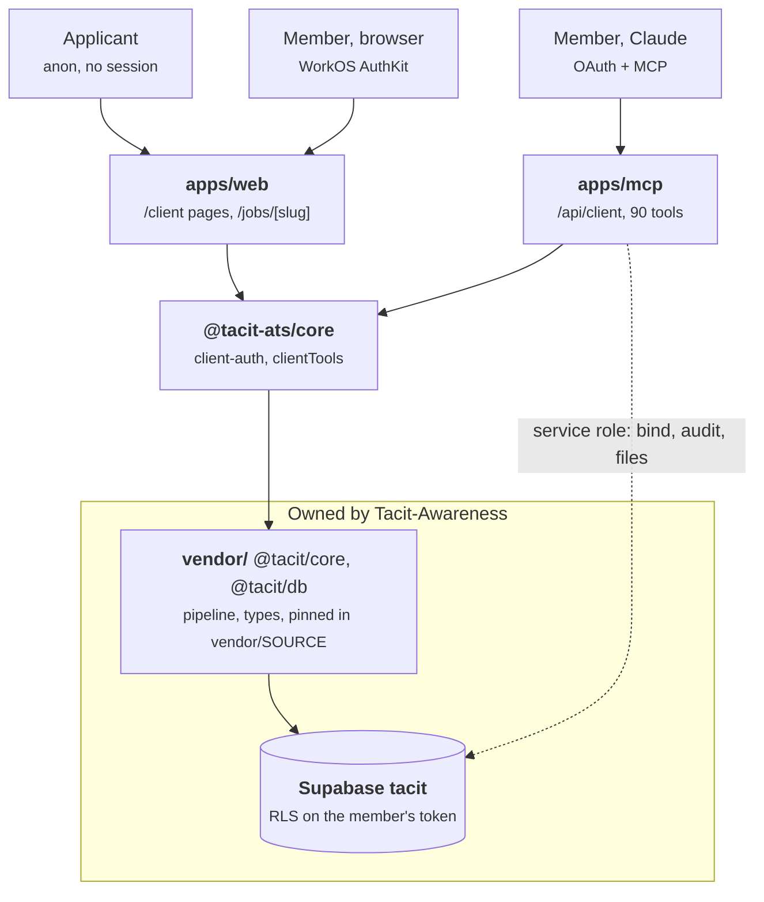

# tacit-ats

Tacit's client-facing ATS: the `/client` portal and the `/api/client` MCP connector for client companies. Shares a database with [Tacit-Awareness](https://github.com/Tacit-Awareness/Tacit-Awareness), which owns the schema; see `CLAUDE.md`.

## Architecture



Every read and write runs on the member's own token, so RLS decides what they see. The dashed edge is the only exception: three modules in `apps/mcp` (`client/bind.ts`, `client/audit.ts`, `client/files.ts`) use the service role, and `apps/web` has the same exception in `lib/client/bind.ts` for first sign-in.

```bash
pnpm install
pnpm test
```
